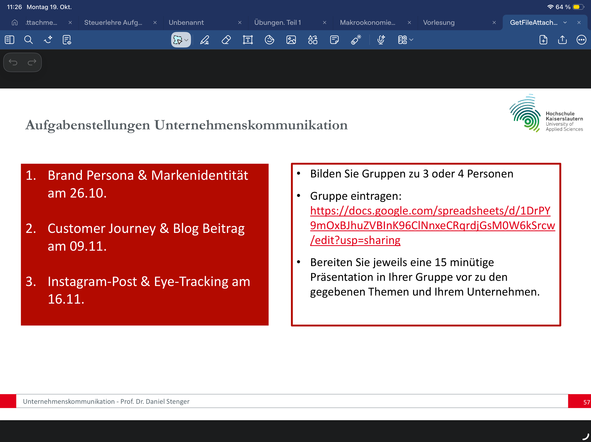
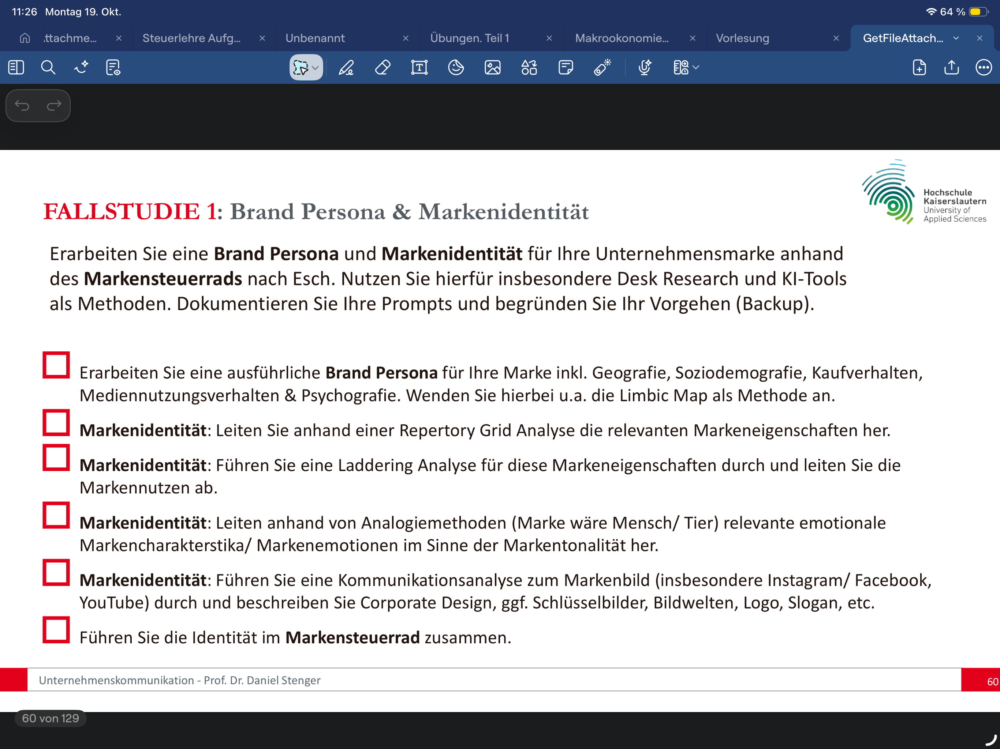
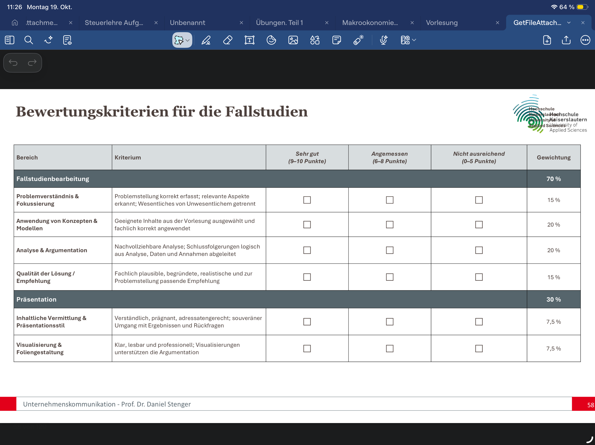
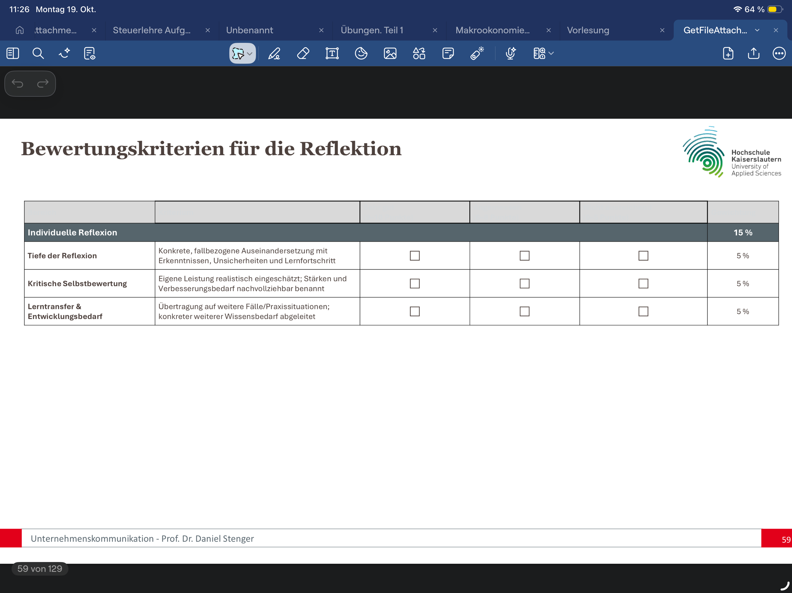

# Aufgabenstellung – Unternehmenskommunikation (Prof. Dr. Daniel Stenger, HS Kaiserslautern)

Transkription der Folien 57–60 aus dem Vorlesungsskript (Screenshots in diesem Ordner).

## Folie 57 – Aufgabenstellungen

| # | Fallstudie | Termin |
|---|---|---|
| **1** | **Brand Persona & Markenidentität** | **26.10.** ← aktuell |
| 2 | Customer Journey & Blog-Beitrag | 09.11. |
| 3 | Instagram-Post & Eye-Tracking | 16.11. |

- Gruppen zu 3 oder 4 Personen
- Jeweils eine **15-minütige Präsentation** in der Gruppe zu den gegebenen Themen und dem eigenen Unternehmen (bei uns: **SNOCKS**)

## Folie 60 – Fallstudie 1: Brand Persona & Markenidentität

> Erarbeiten Sie eine **Brand Persona** und **Markenidentität** für Ihre Unternehmensmarke anhand des **Markensteuerrads** nach Esch. Nutzen Sie hierfür insbesondere Desk Research und KI-Tools als Methoden. Dokumentieren Sie Ihre Prompts und begründen Sie Ihr Vorgehen (Backup).

- [ ] Ausführliche **Brand Persona** inkl. Geografie, Soziodemografie, Kaufverhalten, Mediennutzungsverhalten & Psychografie – u. a. mit der **Limbic Map** als Methode
- [ ] **Markenidentität:** relevante Markeneigenschaften per **Repertory-Grid-Analyse** herleiten
- [ ] **Markenidentität:** **Laddering-Analyse** für diese Markeneigenschaften durchführen und die **Markennutzen** ableiten
- [ ] **Markenidentität:** über **Analogiemethoden** (Marke wäre Mensch/Tier) emotionale Markencharakteristika/Markenemotionen im Sinne der **Markentonalität** herleiten
- [ ] **Markenidentität:** **Kommunikationsanalyse** zum Markenbild (insb. Instagram/Facebook, YouTube) – Corporate Design, Schlüsselbilder, Bildwelten, Logo, Slogan etc.
- [ ] Identität im **Markensteuerrad** zusammenführen

## Folie 58 – Bewertungskriterien Fallstudien

Bewertungsskala je Kriterium: *Sehr gut (9–10 P.)* · *Angemessen (6–8 P.)* · *Nicht ausreichend (0–5 P.)*

| Bereich | Kriterium | Beschreibung | Gewicht |
|---|---|---|---|
| **Fallstudienbearbeitung** | | | **70 %** |
| | Problemverständnis & Fokussierung | Problemstellung korrekt erfasst; relevante Aspekte erkannt; Wesentliches von Unwesentlichem getrennt | 15 % |
| | Anwendung von Konzepten & Modellen | Geeignete Inhalte aus der Vorlesung ausgewählt und fachlich korrekt angewendet | 20 % |
| | Analyse & Argumentation | Nachvollziehbare Analyse; Schlussfolgerungen logisch aus Analyse, Daten und Annahmen abgeleitet | 20 % |
| | Qualität der Lösung / Empfehlung | Fachlich plausible, begründete, realistische und zur Problemstellung passende Empfehlung | 15 % |
| **Präsentation** | | | **30 %** |
| | Inhaltliche Vermittlung & Präsentationsstil | Verständlich, prägnant, adressatengerecht; souveräner Umgang mit Ergebnissen und Rückfragen | 7,5 % |
| | Visualisierung & Foliengestaltung | Klar, lesbar und professionell; Visualisierungen unterstützen die Argumentation | 7,5 % |

## Folie 59 – Bewertungskriterien Reflexion (individuell)

| Kriterium | Beschreibung | Gewicht |
|---|---|---|
| Tiefe der Reflexion | Konkrete, fallbezogene Auseinandersetzung mit Erkenntnissen, Unsicherheiten und Lernfortschritt | 5 % |
| Kritische Selbstbewertung | Eigene Leistung realistisch eingeschätzt; Stärken und Verbesserungsbedarf nachvollziehbar benannt | 5 % |
| Lerntransfer & Entwicklungsbedarf | Übertragung auf weitere Fälle/Praxissituationen; konkreter weiterer Wissensbedarf abgeleitet | 5 % |
| **Summe Individuelle Reflexion** | | **15 %** |

